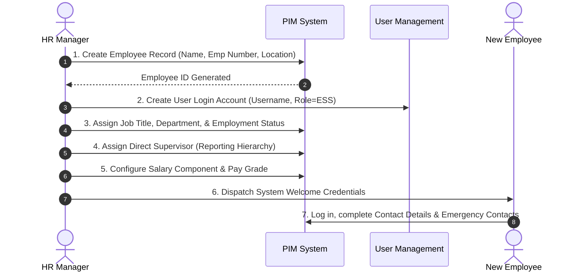
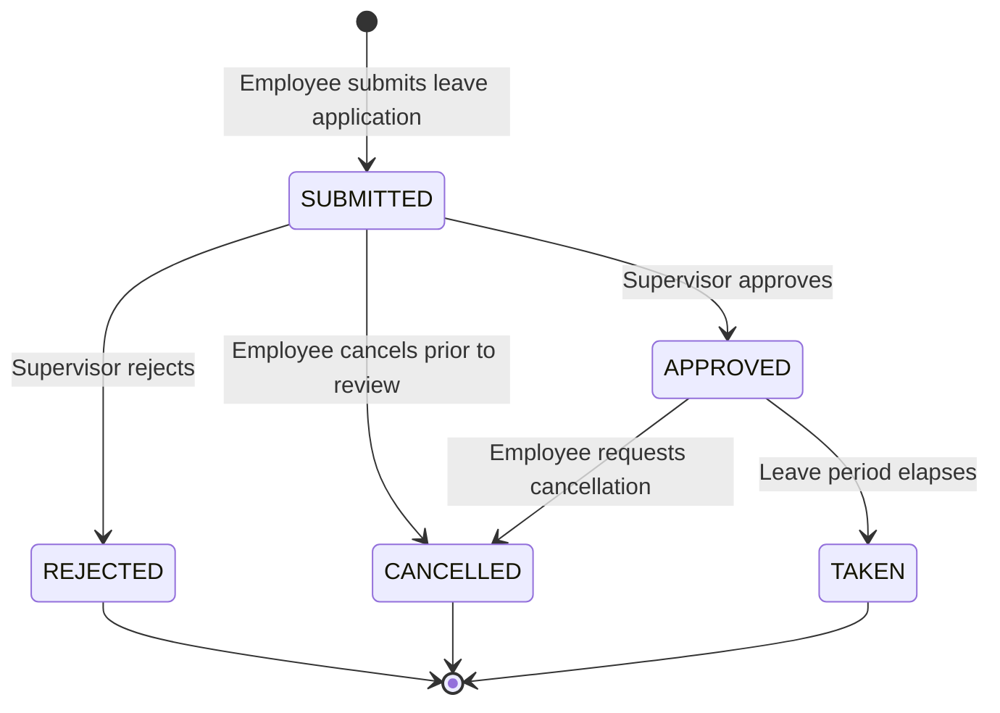
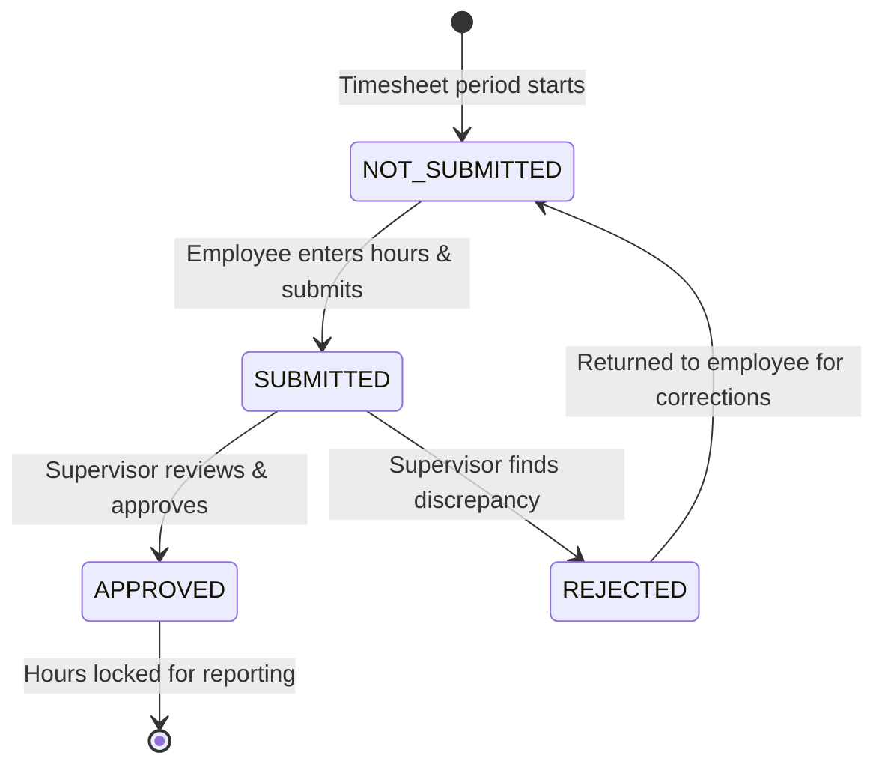
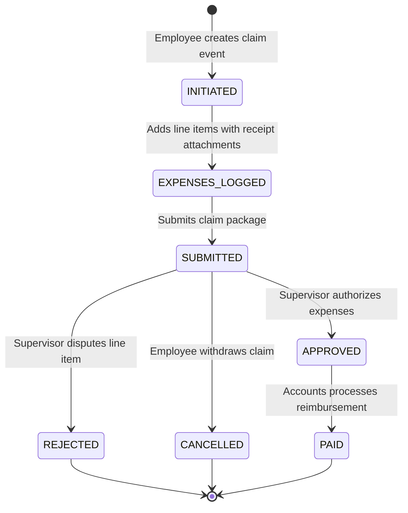

# OrangeHRM v1.0 Business Workflows & State Machines

## 1.0 End-to-End Enterprise Business Workflows

### 1.1 Workflow 1: Employee Onboarding to Operational Readiness

---

### 1.2 Workflow 2: Leave Application, Approval & Balance Reconciliation

#### State Transition Governance Rules:
- Transition from `REJECTED` directly to `APPROVED` without a new application is prohibited.
- Transition from `TAKEN` to `CANCELLED` is prohibited.
- Leave balance is locked/deducted upon `SUBMITTED`; if `REJECTED` or `CANCELLED`, balance is automatically credited back.

---

### 1.3 Workflow 3: Weekly Timesheet Lifecycle & Activity Audit

#### State Transition Governance Rules:
- Approved timesheets cannot be edited by the employee.
- Timesheet hours cannot exceed 24 hours per day per employee.
- Project hours must be tied to an active, assigned customer project and activity.

---

### 1.4 Workflow 4: Candidate Recruitment Pipeline & Hiring Journey

```mermaid
stateDiagram-v2
    [*] --> APPLICATION_INITIATED : Candidate submits resume
    APPLICATION_INITIATED --> SHORTLISTED : Recruiter reviews qualification
    APPLICATION_INITIATED --> REJECTED : Fails initial screening
    SHORTLISTED --> INTERVIEW_SCHEDULED : Interview date & interviewers set
    INTERVIEW_SCHEDULED --> INTERVIEW_PASSED : Panel logs favorable rating
    INTERVIEW_SCHEDULED --> INTERVIEW_FAILED : Panel logs unfavorable rating
    INTERVIEW_PASSED --> JOB_OFFERED : HR extends offer
    JOB_OFFERED --> HIRED : Candidate accepts; record converted to Employee
    JOB_OFFERED --> DECLINED : Candidate declines offer
    INTERVIEW_FAILED --> REJECTED
    DECLINED --> [*]
    REJECTED --> [*]
    HIRED --> [*]
```

---

### 1.5 Workflow 5: Travel & Expense Claim Settlement

