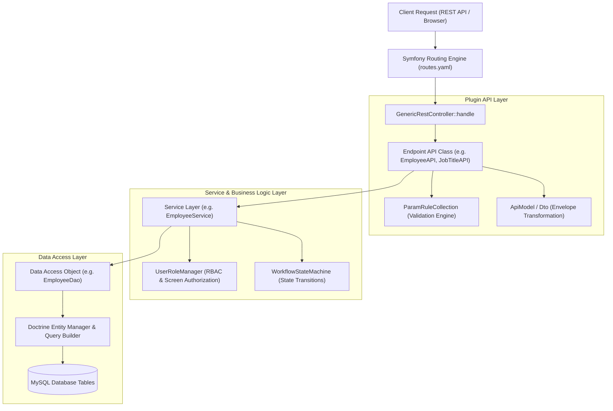

# OrangeHRM v1.0 Component Architecture (C4 Level 3)

## 1.0 Plugin-Driven Component Architecture
OrangeHRM v2 utilizes a decoupled, plugin-based architecture powered by the **Symfony HTTP Kernel** and **Doctrine ORM**.

---

## 2.0 Architectural Interaction Flow (CRUD Endpoint)

1. **Route Resolution:** An incoming request `POST /api/v2/pim/employees` is matched in `orangehrmPimPlugin/config/routes.yaml`.
2. **Controller Dispatch:** Routed to `OrangeHRM\Core\Controller\Rest\V2\GenericRestController::handle`, which resolves the `_api` default: `OrangeHRM\Pim\Api\EmployeeAPI`.
3. **Parameter Validation:** `EmployeeAPI::getValidationRules()` defines parameter constraints via `ParamRuleCollection` (e.g., `Rules::entityUniqueProperty()`, `Rules::string()`, `Rules::length()`).
4. **Security & Role Evaluation:** `UserRoleManager` evaluates token permissions for the target data group.
5. **Service Delegation:** Validated parameters are passed to `EmployeeService::saveEmployee()`.
6. **DAO & Persistence:** `EmployeeDao` creates or updates the `OrangeHRM\Entity\Employee` Doctrine entity and flushes to MySQL.
7. **Response Envelope:** The persisted entity is converted to `EmployeeModel` and formatted into standard JSON response envelope.

