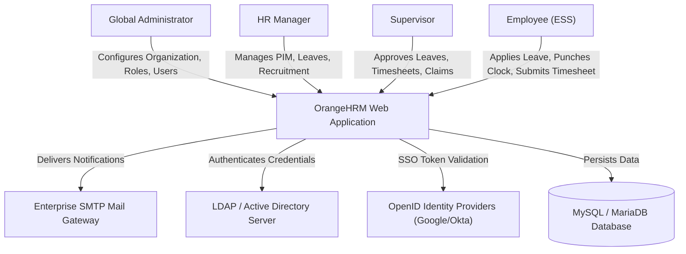
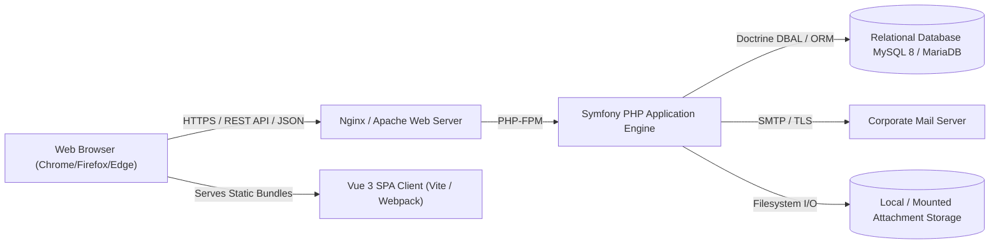

# OrangeHRM v1.0 Software Architecture Document (SAD)
## 1.0 System Context (C4 Model Level 1 & Level 2)

### 1.1 Level 1: System Context Diagram
The System Context diagram illustrates the high-level actors, external services, and operational boundary of the OrangeHRM system.

---

### 1.2 Level 2: Container Diagram
The Container diagram illustrates the high-level technical containers making up the deployed system.

