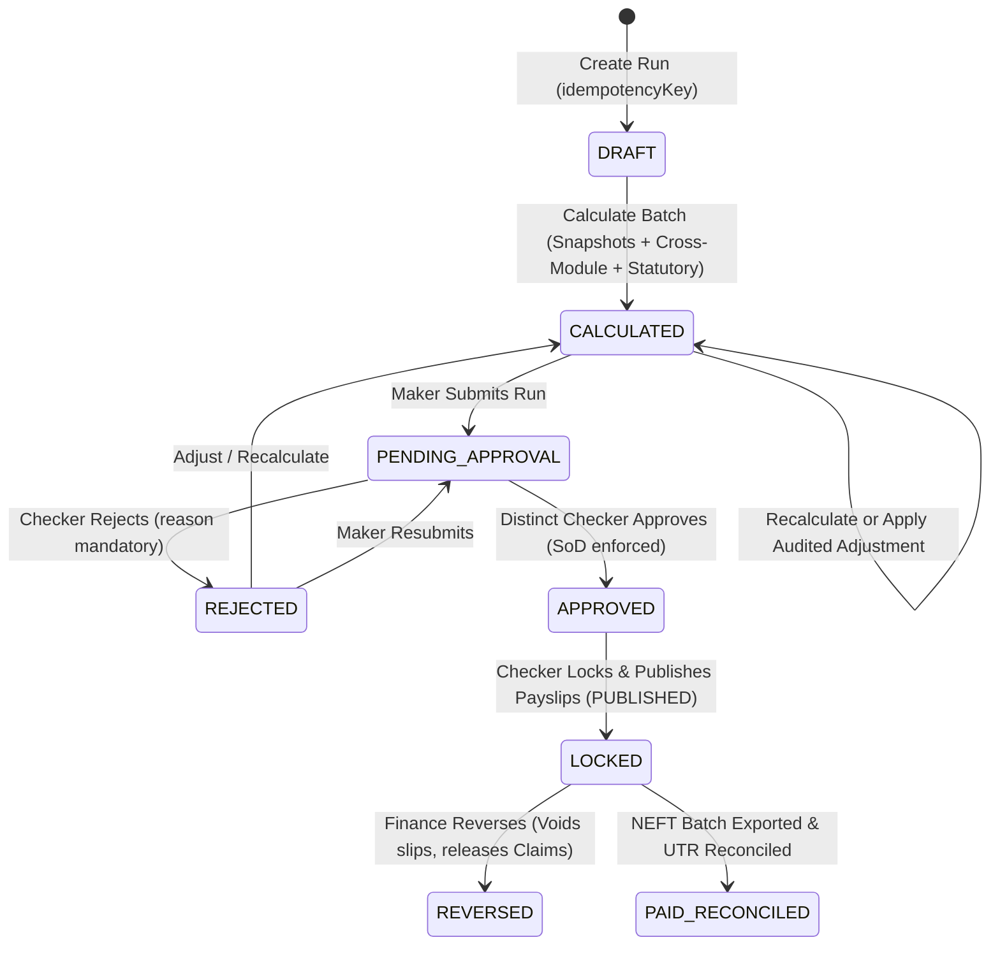

# OrangeHRM v2.2 India Payroll Extension — Business Workflows & State Machines

## 1.0 Payroll Run Lifecycle & Maker-Checker Governance



### State Transition Controls
- Self-approval by `createdBy` or `submittedBy` is rejected with `HTTP 403`.
- Direct jump from `DRAFT` -> `LOCKED` or `CALCULATED` -> `APPROVED` without submission is rejected with `HTTP 409` / `HTTP 422`.
- Locking atomically flips `ohrm_pay_period.status` -> `LOCKED` and publishes `ohrm_salary_slip.slip_status` -> `PUBLISHED`.

---

## 2.0 Cross-Module Data Consumption & Bank Settlement Sequence

```mermaid
sequenceDiagram
    autonumber
    actor Maker as Global Admin (Maker)
    actor Checker as Finance Approver (Role 8)
    participant PIM as PIM Master & Statutory Profile
    participant Leave as Leave (LWP Policy)
    participant Time as Attendance / Timesheet
    participant Claim as Claim Engine
    participant Pay as orangehrmPayrollPlugin
    actor ESS as Employee (Self-Service)

    Maker->>Pay: POST /api/v2/payroll/runs/{id}/calculate
    Pay->>PIM: Read Employee, EmpSalary, Job, EmploymentStatus
    Pay->>Pay: Freeze Snapshot (ohrm_payroll_emp_snapshot) + Mask Bank Account
    Pay->>Leave: Query Approved/Taken Leaves vs ohrm_payroll_leave_policy -> LWP Days
    Pay->>Time: Query Attendance OR Approved Timesheet (non-double-counted) -> OT Hours
    Pay->>Claim: Reserve APPROVED INR Claims (active_claim_lock in ohrm_payroll_claim_link)
    Pay-->>Maker: CALCULATED (4 Eligible, Skipped + Missing Bank Warnings)

    Maker->>Pay: POST /submit
    Checker->>Pay: POST /approve then POST /lock
    Pay-->>ESS: SalarySlip status PUBLISHED -> Downloadable INR HTML Slip

    Checker->>Pay: POST /payment-batches & POST /export
    Pay-->>Checker: 422 Blocked if any employee missing Bank/IFSC; else NEFT CSV
    Checker->>Pay: POST /reconcile (utrOrReason=HDFCN20261201001)
    Pay->>Claim: Transition ohrm_claim_request APPROVED -> PAID
```

