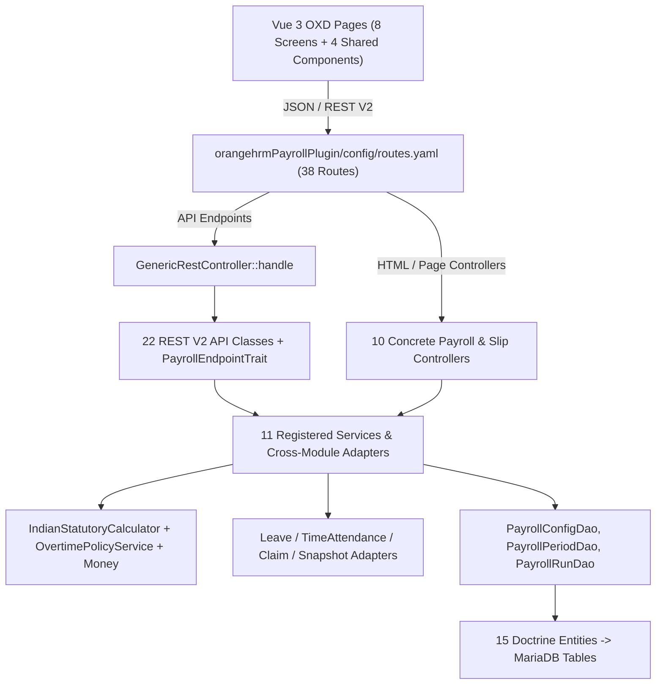

# OrangeHRM v2.2 India Payroll Extension — Component Architecture (C4 Level 3)

## 1.0 Plugin-Internal Layered Architecture

## 2.0 Service Container Bindings (`PayrollPluginConfiguration.php`)
All core services register cleanly into OrangeHRM's Symfony DI container under `OrangeHRM\Framework\Services`:
- `Services::PAYROLL_CONFIG_SERVICE` -> `PayrollConfigService`
- `Services::PAYROLL_SNAPSHOT_SERVICE` -> `PayrollEmployeeSnapshotService`
- `Services::PAYROLL_LEAVE_ADAPTER` -> `LeavePayrollAdapter`
- `Services::PAYROLL_TIME_ADAPTER` -> `TimeAttendancePayrollAdapter`
- `Services::PAYROLL_CLAIM_ADAPTER` -> `ClaimSettlementAdapter`
- `Services::PAYROLL_STATUTORY_CALCULATOR` -> `IndianStatutoryCalculator`
- `Services::PAYROLL_CALCULATION_SERVICE` -> `PayrollCalculationService`
- `Services::PAYROLL_WORKFLOW_SERVICE` -> `PayrollWorkflowService`
- `Services::PAYROLL_APPLICATION_SERVICE` -> `PayrollApplicationService`
- `Services::PAYROLL_PAYMENT_SERVICE` -> `PayrollPaymentService`
- `Services::PAYROLL_SLIP_SERVICE` -> `PayrollSlipService`

