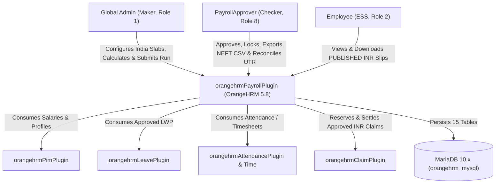

# OrangeHRM v2.2 India Payroll Extension — System Context & Architecture (C4 L1/L2)

## 1.0 System Context (Extension Scope)

## 2.0 Runtime & Frontend Delivery Container View
- **Backend Engine:** PHP `8.1.2` + Symfony 5 HTTP Kernel + Doctrine ORM running inside `orangehrmPayrollPlugin`.
- **Frontend UI:** Vue 3 + TypeScript + `@ohrm/oxd` UI Design System bundled via Webpack (`yarn build`) into `orange_hrm/web/dist/`, matching OrangeHRM orange gradient header/sidebar (`Payroll` icon placed between `Claim` and `Buzz`), card tables, and PIM `edit-employee-layout`.
- **Quality Engineering Telemetry Integration:** Traceable into Neo4j Knowledge Graph (`v2.2-india-payroll`) and surfaced in the `:4500` Quality Engineering Intelligence Platform alongside MariaDB schema checks.

