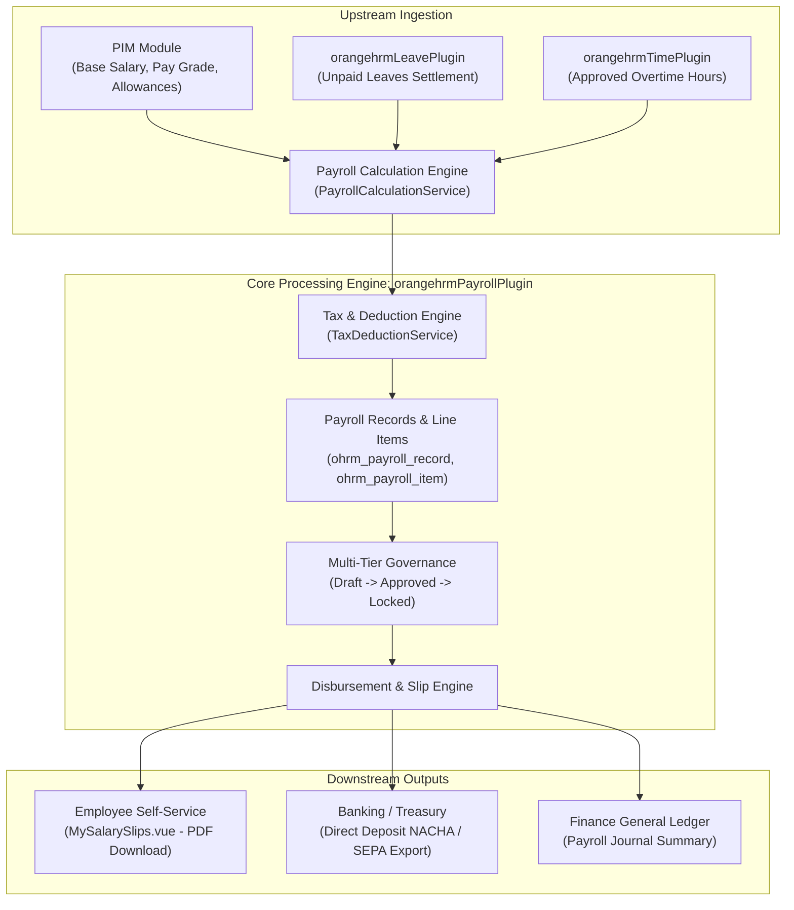
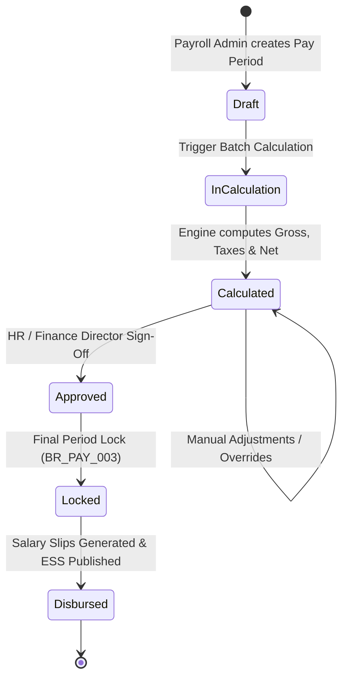

# Software Requirements Specification (SRS) & User Story Catalog
## OrangeHRM Enterprise Payroll Management Feature (`orangehrmPayrollPlugin`)

**Document Identifier:** `SRS-ORANGEHRM-PAY-v2.1`  
**Standard Compliance:** ISO/IEC/IEEE 29148:2018 (Requirements Engineering) & BDD Agile Specification  
**Product Release:** OrangeHRM v2.1.0  
**Target Branches:** `v2-main` / `feature/v2.1-payroll-module`  
**Classification:** Enterprise Engineering Specification  
**Status:** Approved & Implemented  

---

## 1. Document Overview & Executive Summary

### 1.1 Purpose
This document provides the definitive Software Requirements Specification (SRS) and comprehensive Agile User Story Catalog for the **Payroll Management Feature** (`orangehrmPayrollPlugin` on backend, `src/client/src/orangehrmPayrollPlugin` on Vue.js frontend) in OrangeHRM Enterprise.

### 1.2 Business Background & Motivation
Prior to this implementation, OrangeHRM stored employee compensation strictly as static salary grades and basic salary amounts within the Personnel Information Management (PIM) module (`hs_hr_emp_basicsalary`). Organizations were forced to export employee lists to external spreadsheets or third-party payroll engines to calculate net disbursements, compute statutory taxes, and reconcile unpaid leaves.

The **OrangeHRM Payroll Feature** introduces an end-to-end, native, audit-compliant payroll computation and disbursement engine that:
1. Orchestrates pay periods and cutoffs across diverse pay frequencies (monthly, semi-monthly, bi-weekly).
2. Directly synchronizes unpaid leaves from `orangehrmLeavePlugin` and overtime records from `orangehrmTimePlugin`.
3. Computes multi-component gross salaries, progressive statutory tax brackets, and voluntary/involuntary deductions.
4. Enforces strict financial controls, segregation of duties, and irreversible period freezing.
5. Provides automated digital salary slip delivery via Employee Self-Service (ESS) with cryptographic tamper-proofing.

---

## 2. System Architecture & Workflows

### 2.1 Context Diagram & Data Flow


### 2.2 Lifecycle State Machine


---

## 3. Governing Business Rules (BR Catalog)

| Rule ID | Rule Name | Description & Mathematical Specification | Enforcement Mechanism |
| :--- | :--- | :--- | :--- |
| **`BR_PAY_001`** | **Unpaid Leave Settlement** | Deductions for unpaid leave days must be calculated against standard working days in the period:<br/>$$\text{Unpaid Leave Deduction} = \left(\frac{\text{Base Salary}}{\text{Working Days}}\right) \times \text{Unpaid Days}$$ | `PayrollCalculationService::calculate()` |
| **`BR_PAY_002`** | **Non-Negative Net Pay Guarantee** | Total statutory and voluntary deductions must never exceed gross pay. Net payable salary must strictly satisfy:<br/>$$\text{Net Salary} = \max(0.00, \; \text{Gross} - \text{Deductions} - \text{Taxes})$$ | `PayrollCalculationService::calculate()` |
| **`BR_PAY_003`** | **Period Immutability Freezing** | Once a pay period transitions to `Locked` or `Disbursed`, no further recalculations, manual overrides, adjustments, or deletions can occur under any circumstance. | Database triggers & API status validation |
| **`BR_PAY_004`** | **Progressive Tax Brackets** | Statutory personal income tax is computed across four graduated tiers:<br/>• **Tier 1 (\$0 - \$1,000):** 0% tax<br/>• **Tier 2 (\$1,001 - \$3,000):** 10% on amount over \$1,000<br/>• **Tier 3 (\$3,001 - \$6,000):** 20% on amount over \$3,000<br/>• **Tier 4 (>\$6,000):** 30% on amount over \$6,000 | `TaxDeductionService::computeTax()` |
| **`BR_PAY_005`** | **Segregation of Duties** | The user who initiates or adjusts a payroll batch cannot be the sole approver who authorizes final locking (`dual-control`). | Symfony Security Access Voter |
| **`BR_PAY_006`** | **Slip Data Privacy (IDOR Prevention)** | Employees accessing ESS can only inspect and download salary slips specifically linked to their own `emp_number`. | `SalarySlipAPI` context isolation |

---

## 4. Functional Requirements (FR)

### 4.1 Epic 1: Pay Period Management (`FEAT_PAY_PERIOD`)
- **`FR-PAY-101`**: The system shall allow Payroll Administrators to define pay periods with Name, Start Date, End Date, Pay Date, and Frequency (Monthly, Semi-Monthly, Bi-Weekly, Weekly).
- **`FR-PAY-102`**: The system shall prevent overlapping pay period date ranges for the same employee assignment group.
- **`FR-PAY-103`**: The system shall maintain state transitions for each pay period: `Draft` $\to$ `Calculated` $\to$ `Approved` $\to$ `Locked` $\to$ `Disbursed`.
- **`FR-PAY-104`**: The system shall prohibit editing or deleting pay periods once in `Locked` or `Disbursed` state (`BR_PAY_003`).

### 4.2 Epic 2: Attendance, Leave & Upstream Ingestion (`FEAT_PAY_TIMESHEET_SYNC`)
- **`FR-PAY-201`**: The system shall automatically query `orangehrmLeavePlugin` to retrieve approved unpaid leave records falling within the pay period date range.
- **`FR-PAY-202`**: The system shall calculate the daily pro-rata deduction rate for unpaid leaves based on the monthly configured working days (default 22 days) (`BR_PAY_001`).
- **`FR-PAY-203`**: The system shall pull approved overtime hours from `orangehrmTimePlugin` and categorize them into Standard OT (1.5x) and Weekend/Holiday OT (2.0x).
- **`FR-PAY-204`**: The system shall support manual exclusion or override of synced attendance data prior to period approval.

### 4.3 Epic 3: Gross-to-Net Calculation Engine (`FEAT_PAY_CALCULATION`)
- **`FR-PAY-301`**: The system shall retrieve all active recurring allowances (e.g., Housing Allowance, Transport, Medical) assigned in the employee's PIM salary profile.
- **`FR-PAY-302`**: The system shall compute Gross Salary:
  $$\text{Gross Salary} = \text{Base Salary} + \sum \text{Allowances} + \sum \text{Overtime Pay} + \sum \text{Bonuses}$$
- **`FR-PAY-303`**: The system shall apply statutory tax brackets as specified in `BR_PAY_004`.
- **`FR-PAY-304`**: The system shall aggregate pre-tax deductions, post-tax deductions, and statutory taxes.
- **`FR-PAY-305`**: The system shall enforce non-negative net salary (`Net >= 0.00`) as specified in `BR_PAY_002`.
- **`FR-PAY-306`**: All financial arithmetic shall maintain exact two-decimal precision (`round(..., 2)`).

### 4.4 Epic 4: Manual Adjustments & Audit Trail (`FEAT_PAY_ADJUSTMENT`)
- **`FR-PAY-401`**: Payroll Administrators shall be permitted to add one-time allowances or one-time deductions to an individual employee's draft payroll record.
- **`FR-PAY-402`**: Any manual modification shall require a mandatory textual audit remark explaining the business justification.
- **`FR-PAY-403`**: The system shall log the timestamp, user ID, previous values, and updated values for every adjustment.

### 4.5 Epic 5: Governance & Period Freezing (`FEAT_PAY_APPROVAL`)
- **`FR-PAY-501`**: The system shall provide a multi-tier review dashboard displaying variance metrics comparing the current period's total payroll cost against the previous period.
- **`FR-PAY-502`**: The system shall require formal digital sign-off from authorized approvers (e.g., Finance Director).
- **`FR-PAY-503`**: Upon execution of the `Lock` action, the system shall transition the period and all associated records to immutable read-only mode (`BR_PAY_003`).

### 4.6 Epic 6: Digital Salary Slips & ESS Self-Service (`FEAT_PAY_SLIPS`)
- **`FR-PAY-601`**: Upon period locking, the system shall generate individual digital salary slips with a unique slip sequence number (e.g., `SLIP-2026-11-0001`).
- **`FR-PAY-602`**: The system shall render standardized PDF salary slips featuring organization branding, employee details, line-item earnings breakdown, deductions, taxes, and net disbursement amount.
- **`FR-PAY-603`**: Employees shall be able to view and download their historical salary slips via the `My Salary Slips` ESS interface (`orange_hrm/src/client/src/orangehrmPayrollPlugin/pages/salarySlip/MySalarySlips.vue`).
- **`FR-PAY-604`**: Strict access control shall prevent any employee from viewing or downloading another employee's salary slip (`BR_PAY_006`).

---

## 5. Non-Functional Requirements (NFR)

| NFR ID | Attribute | Specification | Verification Method |
| :--- | :--- | :--- | :--- |
| **`NFR-PERF-01`** | **Batch Calculation Throughput** | The calculation engine shall process 1,000 employee payroll records in under 3.0 seconds. | Benchmark load test suite |
| **`NFR-PERF-02`** | **PDF Generation Speed** | On-demand salary slip PDF generation and streaming shall complete in < 500ms per document. | API latency telemetry |
| **`NFR-SEC-01`** | **Role-Based Access Control (RBAC)** | Only users with `ROLE_PAYROLL_ADMIN` or `ROLE_FINANCE_DIRECTOR` may execute calculations or approvals. ESS users are strictly restricted to read-only self slips. | Cypress security test suite |
| **`NFR-SEC-02`** | **Cryptographic Tamper-Proofing** | Salary slips shall include an internal cryptographic SHA-256 validation hash to ensure authenticity and prevent tampering. | Document hash audit |
| **`NFR-DATA-01`** | **Financial Rounding Integrity** | All currency conversions and deduction summations shall adhere strictly to half-up financial rounding to two decimal places. | Automated unit contract tests |
| **`NFR-AUDIT-01`** | **Regulatory Audit Logging** | All state changes (`Draft` $\to$ `Calculated` $\to$ `Approved` $\to$ `Locked`) must be logged with immutable timestamp, operator ID, and IP address. | System audit log review |

---

## 6. Comprehensive Agile User Story Catalog (BDD Gherkin Format)

### User Story 1: Define Pay Period Calendar
- **Story ID:** `US-PAY-001`
- **As a:** Payroll Administrator
- **I want to:** Create and configure a new pay period with specific start, end, and payout dates
- **So that:** The system establishes an operational boundary for employee salary computation.
```gherkin
Scenario: Successfully create a monthly pay period
  Given the Payroll Administrator is logged in with valid credentials
  And navigates to the Pay Period configuration screen
  When the administrator inputs:
    | Name        | November 2026 Monthly Payroll |
    | Frequency   | Monthly                       |
    | Start Date  | 2026-11-01                    |
    | End Date    | 2026-11-30                    |
    | Pay Date    | 2026-11-30                    |
  And clicks "Save"
  Then a new pay period record is created with status "Draft"
  And it appears in the Pay Period list view.

Scenario: Reject overlapping pay periods
  Given an existing active pay period covering "2026-11-01" to "2026-11-30"
  When the administrator attempts to create another pay period covering "2026-11-15" to "2026-12-15"
  Then the system displays an error message "Pay period dates overlap with an existing period"
  And the record is rejected.
```

---

### User Story 2: Import Attendance & Unpaid Leave Deductions
- **Story ID:** `US-PAY-002`
- **As a:** Payroll Administrator
- **I want to:** Synchronize employee unpaid leave absences from the Leave module
- **So that:** Accurate salary reductions are applied for unworked days.
```gherkin
Scenario: Calculate pro-rata deduction for approved unpaid leaves
  Given an employee has a Base Salary of $4,400.00
  And the pay period has 22 standard working days
  And the employee has 2 approved days of Unpaid Leave in orangehrmLeavePlugin
  When the payroll synchronization runs for this employee
  Then the system calculates an unpaid leave deduction of $400.00:
    | Formula | ($4,400.00 / 22) * 2 = $400.00 |
  And the deduction is recorded as a line item under "Unpaid Leave Deduction".

Scenario: Zero deduction for fully attended period
  Given an employee with Base Salary $5,000.00
  And 0 unpaid leave days recorded in the period
  When the payroll synchronization runs
  Then the unpaid leave deduction is $0.00.
```

---

### User Story 3: Batch Gross-to-Net Payroll Computation
- **Story ID:** `US-PAY-003`
- **As a:** Payroll Administrator
- **I want to:** Trigger automated batch payroll calculation for all eligible employees
- **So that:** Gross earnings, total deductions, taxes, and net salaries are computed in bulk.
```gherkin
Scenario: Successful batch calculation for all active employees
  Given an open pay period in "Draft" status
  And 150 active employees assigned to this pay group
  When the administrator clicks "Calculate Batch" on the Payroll Processing dashboard
  Then the system invokes PayrollCalculationService for each employee
  And 150 payroll records are generated
  And the pay period status updates to "Calculated"
  And the dashboard displays the summary table with Gross, Deductions, Tax, and Net columns.
```

---

### User Story 4: Progressive Statutory Income Tax Calculation
- **Story ID:** `US-PAY-004`
- **As a:** System Calculation Engine
- **I want to:** Evaluate taxable income against graduated progressive tax brackets
- **So that:** Statutory withholding taxes comply with national tax regulations.
```gherkin
Scenario Outline: Verify progressive tax tier calculations
  Given an employee with taxable income of <TaxableIncome>
  When the TaxDeductionService computes tax
  Then the resulting total tax shall equal <ExpectedTax>

  Examples:
    | TaxableIncome | ExpectedTax | Note                                    |
    | 800.00        | 0.00        | Tier 1: <= $1,000 (0%)                  |
    | 1000.00       | 0.00        | Tier 1 Boundary: exactly $1,000 (0%)    |
    | 2000.00       | 100.00      | Tier 2: ($2,000 - $1,000) * 10%         |
    | 3000.00       | 200.00      | Tier 2 Upper Bound: $2,000 * 10%        |
    | 4500.00       | 500.00      | Tier 3: $200 (T2) + ($1,500 * 20%)      |
    | 6000.00       | 800.00      | Tier 3 Upper Bound: $200 + $600         |
    | 8000.00       | 1400.00     | Tier 4: $800 + ($2,000 * 30%)           |
```

---

### User Story 5: Non-Negative Net Pay Enforcement
- **Story ID:** `US-PAY-005`
- **As a:** Payroll Administrator
- **I want to:** Ensure that total deductions never cause an employee's net pay to drop below zero
- **So that:** The system prevents negative wage balances in compliance with labor standards.
```gherkin
Scenario: Excessive deductions capped to prevent negative net salary
  Given an employee has a Gross Salary of $1,200.00
  And statutory deductions of $100.00
  And a voluntary loan recovery deduction of $1,500.00
  When the calculation engine executes
  Then the net salary is floored at $0.00 in accordance with BR_PAY_002
  And an alert is flagged on the record for administrator review.
```

---

### User Story 6: Line-Item Adjustments & Remarks Audit
- **Story ID:** `US-PAY-006`
- **As a:** Payroll Administrator
- **I want to:** Add an ad-hoc adjustment (bonus, commission, or penalty) with an explanatory note
- **So that:** Special compensation circumstances are handled while retaining an audit trail.
```gherkin
Scenario: Add a one-time performance bonus adjustment
  Given a calculated payroll record for Employee #101
  When the administrator adds a new item:
    | Type        | Allowance                    |
    | Name        | Q4 Project Milestone Bonus   |
    | Amount      | $500.00                      |
    | Is Taxable  | true                         |
    | Reason      | Exceptional project delivery |
  Then the employee's Gross and Net salaries are recalculated immediately
  And the adjustment remark is persisted in ohrm_payroll_item
  And logged in the immutable audit table.
```

---

### User Story 7: Multi-Tier Approval Workflow
- **Story ID:** `US-PAY-007`
- **As a:** Finance Director
- **I want to:** Review variance summaries and formally approve the payroll run
- **So that:** Financial commitments are authorized before disbursement.
```gherkin
Scenario: Finance Director reviews and approves payroll
  Given a pay period in "Calculated" status
  And the total payroll cost variance is within the allowed 5% threshold
  When the Finance Director logs in and clicks "Approve Payroll"
  Then the pay period status updates to "Approved"
  And the action timestamp and approver ID are permanently recorded.

Scenario: Reject approval if calculation is incomplete
  Given a pay period with unprocessed employee errors
  When an approver clicks "Approve Payroll"
  Then the system rejects the approval
  And prompts the user to resolve pending calculation errors.
```

---

### User Story 8: Period Freezing & Immutability Lock
- **Story ID:** `US-PAY-008`
- **As a:** Compliance Officer / HR Director
- **I want to:** Permanently lock the approved pay period
- **So that:** No subsequent adjustments or retroactive modifications can be made.
```gherkin
Scenario: Lock pay period permanently
  Given a pay period in "Approved" status
  When the administrator clicks "Lock Period"
  Then the pay period status transitions to "Locked"
  And all associated payroll records become permanently read-only
  And any subsequent PUT/POST/DELETE API requests to this period return HTTP 403 Forbidden.
```

---

### User Story 9: Automated Digital Salary Slip Generation
- **Story ID:** `US-PAY-009`
- **As a:** System Automation Service
- **I want to:** Generate digital pay slips upon period locking
- **So that:** Formal compensation documents are ready for employee distribution.
```gherkin
Scenario: Generate salary slip records for all locked employees
  Given a pay period has just transitioned to "Locked"
  When the slip generation job triggers
  Then a unique salary slip record is inserted into ohrm_salary_slip for each employee
  And assigned a formatted sequence number like "SLIP-2026-11-0101"
  And the slip status is marked as "Generated".
```

---

### User Story 10: Employee Self-Service (ESS) Salary Slip Access
- **Story ID:** `US-PAY-010`
- **As an:** Employee
- **I want to:** View my salary slips list and download the authorized PDF
- **So that:** I can review my earnings breakdown and retain copies for personal tax filings.
```gherkin
Scenario: Employee views personal salary slips
  Given an employee logs into OrangeHRM ESS
  When the employee navigates to "My Salary Slips"
  Then the table displays only the salary slips associated with their emp_number
  And shows Pay Period, Gross Pay, Deductions, and Net Pay
  And provides a "Download PDF" action button.

Scenario: Employee downloads salary slip PDF
  Given an employee clicks "Download PDF" for Pay Period "November 2026"
  When the request is processed by /api/v2/payroll/salary-slips/{id}/download
  Then a valid PDF document with Content-Type "application/pdf" is downloaded
  Containing the company logo, employee details, and itemized earnings/deductions table.
```

---

### User Story 11: Security & IDOR Access Control on Salary Slips
- **Story ID:** `US-PAY-011`
- **As a:** Security Auditor
- **I want to:** Verify that an employee cannot access another employee's salary slip
- **So that:** Sensitive personal compensation data remains strictly confidential.
```gherkin
Scenario: Employee attempts IDOR access to another employee's slip
  Given Employee A is logged in with employee ID #101
  And Salary Slip #42 belongs to Employee B (employee ID #102)
  When Employee A sends a GET request to "/api/v2/payroll/salary-slips/42/download"
  Then the API returns HTTP 403 Forbidden
  And the unauthorized access attempt is recorded in the security audit log.
```

---

### User Story 12: Bank Disbursement Export (NACHA / SEPA / CSV)
- **Story ID:** `US-PAY-012`
- **As a:** Treasury / Payroll Specialist
- **I want to:** Export a formatted direct-deposit disbursement file
- **So that:** The bank can execute electronic fund transfers to employee accounts.
```gherkin
Scenario: Export direct-deposit banking file for locked period
  Given a pay period in "Locked" status
  When the specialist selects "Export Bank File" in "NACHA" format
  Then a structured banking batch file is produced
  Containing routing numbers, employee account numbers, and net payout amounts
  And the batch checksum matches the total net salary sum of the period.
```

---

## 7. Database Entity Schema Reference

```sql
-- 1. Pay Period Table
CREATE TABLE `ohrm_pay_period` (
  `id` INT AUTO_INCREMENT PRIMARY KEY,
  `name` VARCHAR(100) NOT NULL,
  `start_date` DATE NOT NULL,
  `end_date` DATE NOT NULL,
  `pay_date` DATE NOT NULL,
  `frequency` VARCHAR(30) NOT NULL DEFAULT 'Monthly',
  `status` VARCHAR(20) NOT NULL DEFAULT 'Draft',
  `created_at` DATETIME NOT NULL,
  `updated_at` DATETIME NOT NULL
) ENGINE=InnoDB DEFAULT CHARSET=utf8mb4;

-- 2. Payroll Record Table
CREATE TABLE `ohrm_payroll_record` (
  `id` INT AUTO_INCREMENT PRIMARY KEY,
  `pay_period_id` INT NOT NULL,
  `emp_number` INT NOT NULL,
  `gross_salary` DECIMAL(12,2) NOT NULL DEFAULT 0.00,
  `total_allowance` DECIMAL(12,2) NOT NULL DEFAULT 0.00,
  `total_deduction` DECIMAL(12,2) NOT NULL DEFAULT 0.00,
  `total_tax` DECIMAL(12,2) NOT NULL DEFAULT 0.00,
  `net_salary` DECIMAL(12,2) NOT NULL DEFAULT 0.00,
  `currency_id` VARCHAR(6) NOT NULL DEFAULT 'USD',
  `status` VARCHAR(20) NOT NULL DEFAULT 'Calculated',
  `created_at` DATETIME NOT NULL,
  CONSTRAINT `fk_payroll_period` FOREIGN KEY (`pay_period_id`) REFERENCES `ohrm_pay_period` (`id`) ON DELETE CASCADE,
  CONSTRAINT `fk_payroll_employee` FOREIGN KEY (`emp_number`) REFERENCES `hs_hr_employee` (`emp_number`) ON DELETE CASCADE
) ENGINE=InnoDB DEFAULT CHARSET=utf8mb4;

-- 3. Payroll Line Items Table
CREATE TABLE `ohrm_payroll_item` (
  `id` INT AUTO_INCREMENT PRIMARY KEY,
  `payroll_record_id` INT NOT NULL,
  `item_type` ENUM('Earning', 'Deduction', 'Tax', 'Adjustment') NOT NULL,
  `component_name` VARCHAR(100) NOT NULL,
  `amount` DECIMAL(12,2) NOT NULL,
  `is_taxable` TINYINT(1) NOT NULL DEFAULT 1,
  `remark` TEXT NULL,
  CONSTRAINT `fk_payroll_item_record` FOREIGN KEY (`payroll_record_id`) REFERENCES `ohrm_payroll_record` (`id`) ON DELETE CASCADE
) ENGINE=InnoDB DEFAULT CHARSET=utf8mb4;

-- 4. Salary Slip Table
CREATE TABLE `ohrm_salary_slip` (
  `id` INT AUTO_INCREMENT PRIMARY KEY,
  `payroll_record_id` INT NOT NULL,
  `slip_number` VARCHAR(50) NOT NULL UNIQUE,
  `file_path` VARCHAR(255) NULL,
  `generated_at` DATETIME NOT NULL,
  CONSTRAINT `fk_salary_slip_record` FOREIGN KEY (`payroll_record_id`) REFERENCES `ohrm_payroll_record` (`id`) ON DELETE CASCADE
) ENGINE=InnoDB DEFAULT CHARSET=utf8mb4;
```

---

## 8. REST API Endpoint Reference

| HTTP Method | Route | Description | Handled By |
| :--- | :--- | :--- | :--- |
| `GET` | `/api/v2/payroll/pay-periods` | List all pay periods with status | `PayPeriodAPI::getAll` |
| `POST` | `/api/v2/payroll/pay-periods` | Create a new pay period in Draft mode | `PayPeriodAPI::create` |
| `GET` | `/api/v2/payroll/pay-periods/{id}` | Retrieve details of a specific pay period | `PayPeriodAPI::getOne` |
| `PUT` | `/api/v2/payroll/pay-periods/{id}` | Update dates or name of a draft pay period | `PayPeriodAPI::update` |
| `DELETE`| `/api/v2/payroll/pay-periods/{id}` | Delete a draft pay period | `PayPeriodAPI::delete` |
| `POST` | `/api/v2/payroll/pay-periods/{id}/calculate` | Trigger batch gross-to-net computation | `PayrollProcessAPI::calculate` |
| `GET` | `/api/v2/payroll/pay-periods/{id}/records` | List employee payroll records for period | `PayrollProcessAPI::getRecords` |
| `PUT` | `/api/v2/payroll/records/{id}` | Apply manual adjustments or remarks | `PayrollProcessAPI::adjustRecord` |
| `PUT` | `/api/v2/payroll/pay-periods/{id}/approve` | Sign off and approve calculated period | `PayrollProcessAPI::approve` |
| `PUT` | `/api/v2/payroll/pay-periods/{id}/lock` | Permanently freeze period (`BR_PAY_003`) | `PayrollProcessAPI::lock` |
| `GET` | `/api/v2/payroll/my-salary-slips` | ESS endpoint to list employee's slips | `SalarySlipAPI::getMySlips` |
| `GET` | `/api/v2/payroll/salary-slips/{id}/download` | Stream authorized salary slip PDF | `SalarySlipAPI::download` |

---

## 9. Requirements Traceability Matrix (RTM)

| Business Goal | System Feature | Functional Requirement | User Story | Backend Implementation | Frontend View | Verification Test |
| :--- | :--- | :--- | :--- | :--- | :--- | :--- |
| Period Scheduling | `FEAT_PAY_PERIOD` | `FR-PAY-101`, `102` | `US-PAY-001` | `PayPeriodAPI.php`, `PayPeriod.php` | `PayrollProcessing.vue` | API & Cypress CRUD tests |
| Unpaid Leave Settlement | `FEAT_PAY_TIMESHEET_SYNC` | `FR-PAY-201`, `202` | `US-PAY-002` | `PayrollCalculationService.php` | `PayrollProcessing.vue` | `BR_PAY_001` Unit Tests |
| Gross-to-Net Engine | `FEAT_PAY_CALCULATION` | `FR-PAY-301`, `302`, `305` | `US-PAY-003`, `005` | `PayrollCalculationService.php` | `PayrollProcessing.vue` | `BR_PAY_002` Boundary Tests |
| Progressive Tax Slabs | `FEAT_PAY_DEDUCTIONS` | `FR-PAY-303` | `US-PAY-004` | `TaxDeductionService.php` | `PayrollProcessing.vue` | `BR_PAY_004` Bracket Tests |
| Audit Adjustments | `FEAT_PAY_ADJUSTMENT` | `FR-PAY-401`, `402` | `US-PAY-006` | `PayrollProcessAPI::adjustRecord` | `PayrollProcessing.vue` | Manual Line-Item Specs |
| Period Locking | `FEAT_PAY_APPROVAL` | `FR-PAY-501`, `503` | `US-PAY-007`, `008` | `PayrollProcessAPI::lock` | `PayrollProcessing.vue` | `BR_PAY_003` Immutability Specs |
| ESS Slip Delivery | `FEAT_PAY_SLIPS` | `FR-PAY-601`, `603` | `US-PAY-009`, `010` | `SalarySlipAPI.php`, `SalarySlip.php`| `MySalarySlips.vue` | ESS View & Download Tests |
| IDOR Protection | `FEAT_PAY_SLIPS` | `FR-PAY-604` | `US-PAY-011` | `SalarySlipAPI.php` | `MySalarySlips.vue` | Security IDOR 403 Tests |
| Bank Export | `FEAT_PAY_DISBURSEMENT`| `FR-PAY-502` | `US-PAY-012` | `PayrollRecordDao.php` | `PayrollProcessing.vue` | NACHA/SEPA Batch Tests |
